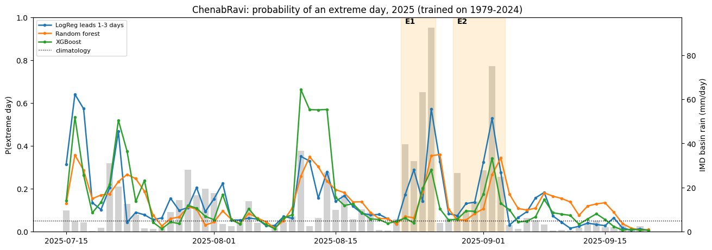
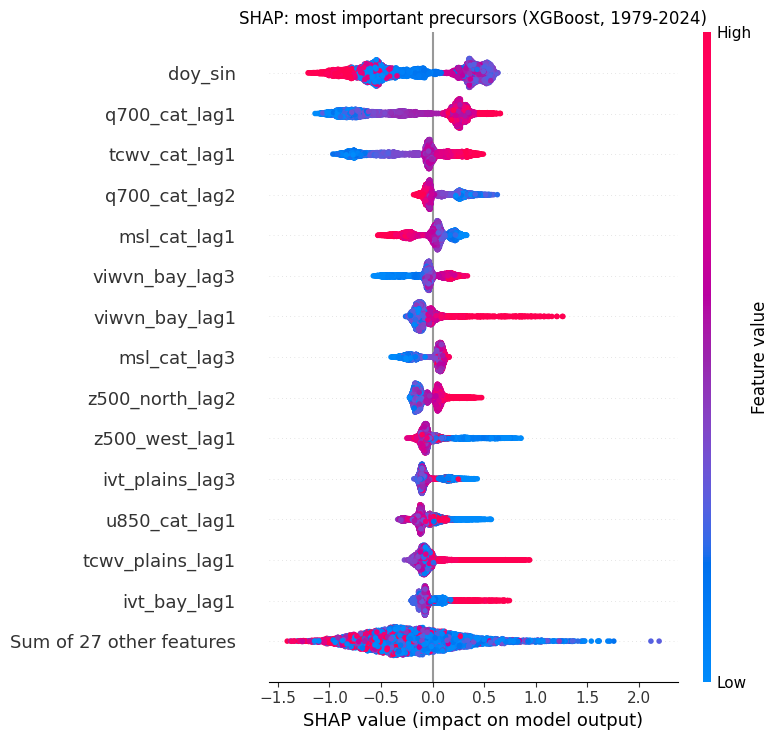
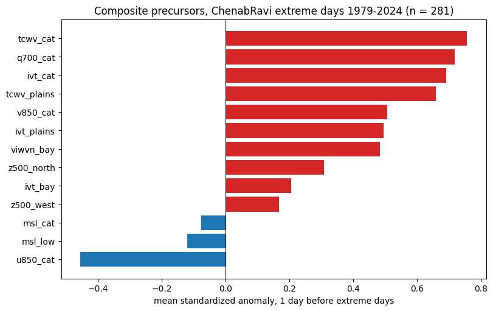
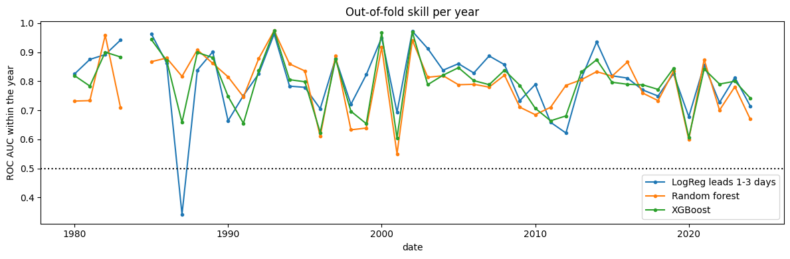

# Forecasting extreme rainfall days over the Chenab and Ravi catchments with machine learning

Can atmospheric precursors 1 to 3 days ahead tell us when an extreme rain day is coming over the Chenab and Ravi catchments (western Himalaya, upstream of Punjab, Pakistan)? This repository trains and explains machine learning models on 47 monsoon seasons (1979-2025), with the August-September 2025 Punjab floods as an independent test.

> **Status:** first baseline (October 2026). Results are preliminary and will be updated.

## Data

| Role | Dataset | Period | Details |
|---|---|---|---|
| Labels | IMD daily gridded rainfall, 0.25° (Pai et al., 2014) | 1979-2025, June-September | basin mean over Chenab + Ravi; rain-day = 24 h ending 08:30 IST |
| Predictors | ERA5 reanalysis (Hersbach et al., 2020), Copernicus Climate Data Store | 1979-2025, May-September | 03/09/15/21 UTC averaged to the same 03-03 UTC day, 22-38° N, 64-88° E, coarsened to 1° |

**Extreme day:** basin rain at or above the 95th percentile of all June-September days 1979-2024 (18.9 mm/day). This gives 281 extreme days in 1979-2024 (about 6 per season) and 14 in 2025.

**Predictors (41):** box-mean anomalies of integrated vapour transport (IVT), total column water vapour, 700 hPa specific humidity, 850 hPa winds, sea-level pressure and 500 hPa height over six physically motivated boxes (catchment, foothill plains, Bay of Bengal corridor, monsoon-low region, westerly-trough region, northern ridge), at leads of 1, 2 and 3 days, plus two seasonal terms. Anomalies are relative to the 1979-2024 day-of-year climatology.

## Method

- **Models:** logistic regression, random forest and XGBoost, compared with persistence (yesterday's rain) and climatology.
- **Honest validation:** 5-fold cross-validation by blocks of consecutive years (no year is ever predicted by a model that saw it), and 2025 kept completely aside as an independent test.
- **Scores for a rare event (base rate 5%):** ROC AUC, PR AUC, Brier skill score, hit rate of the 5% highest-probability days.
- **Explainability:** SHAP (TreeExplainer) for XGBoost, globally and for the 2025 flood episodes.

## First results (cross-validated, 1979-2024)

| Model | ROC AUC | PR AUC | Brier skill score | Top-5% days that were extreme |
|---|---|---|---|---|
| Persistence (yesterday's rain) | 0.76 | 0.22 | 0.07 | 29% |
| Logistic regression, leads 1-3 days | **0.81** | 0.20 | 0.07 | 22% |
| Random forest | 0.80 | 0.20 | 0.08 | 24% |
| XGBoost | 0.80 | 0.19 | 0.07 | 24% |

- Atmospheric precursors alone give clear skill (ROC AUC about 0.8; PR AUC about 4 times the base rate). Non-linear models do not beat logistic regression with these box-mean features, so the limit is the information in the features rather than the model.
- Persistence catches more of the strongest days because extreme days come in multi-day spells; the precursor models instead rise **before** a spell starts. Combining both is the next step.
- **2025 floods:** for the peak days of the two episodes (26 August and 2 September 2025) the XGBoost probability rose to 0.29 and 0.34, about 6-7 times climatology.

## What the model learned (SHAP)

The most important precursors are 700 hPa humidity and water vapour over the catchment, northward moisture flux from the Bay of Bengal, low sea-level pressure over the catchment, and the 500 hPa pattern of a ridge to the north with a trough to the west. This matches the known mechanism of monsoon moisture interacting with westerly disturbances over the western Himalaya. The 1-day lead carries most information, with useful signal at 2-3 days.

| | |
|---|---|
|  |  |
| Mean anomaly one day before extreme days | Cross-validated skill in each year |

## Notebooks (run in order in Google Colab)

| Notebook | What it does |
|---|---|
| `ML01_Labels_IMD.ipynb` | downloads IMD rainfall, builds basin means and extreme-day labels |
| `ML02_ERA5_Download.ipynb` | downloads and processes ERA5 predictors (needs a free CDS account; put your own key in the setup cell) |
| `ML03_Features.ipynb` | builds anomaly features at 1-3 day leads and the composite plot |
| `ML04_LogReg_Baseline.ipynb` | logistic regression vs persistence, reliability, 2025 test |
| `ML05_Trees_RF_XGB.ipynb` | random forest and XGBoost, skill by year |
| `ML06_SHAP_Explain.ipynb` | SHAP explanations and summary |

Basin boundaries (shapefiles) are not included. The notebooks expect them in a Google Drive folder; any polygon of the Chenab and Ravi catchments can be used.

## Next steps

- Combine precursors with persistence, and track the position of monsoon lows instead of a box mean.
- Learn directly from gridded ERA5 and satellite (IMERG, Meteosat) fields with convolutional networks.
- Extend to the Beas and Sutlej catchments and test longer leads.

## References

- Pai, D. S. et al. (2014). Development of a new high spatial resolution (0.25° × 0.25°) long period (1901-2010) daily gridded rainfall data set over India. *Mausam*, 65(1), 1-18.
- Hersbach, H. et al. (2020). The ERA5 global reanalysis. *Q. J. R. Meteorol. Soc.*, 146, 1999-2049.
- Lundberg, S. M. & Lee, S.-I. (2017). A unified approach to interpreting model predictions. *NeurIPS*.

ERA5 data: Copernicus Climate Change Service (C3S) Climate Data Store. IMD data: India Meteorological Department, Pune.

## Author

Shafqat Ali, Assistant GIS, Provincial Disaster Management Authority (PDMA), Punjab, Pakistan. M.Phil. Space Science, University of the Punjab. Contact: shafqat.rsgcrl@pu.edu.pk
